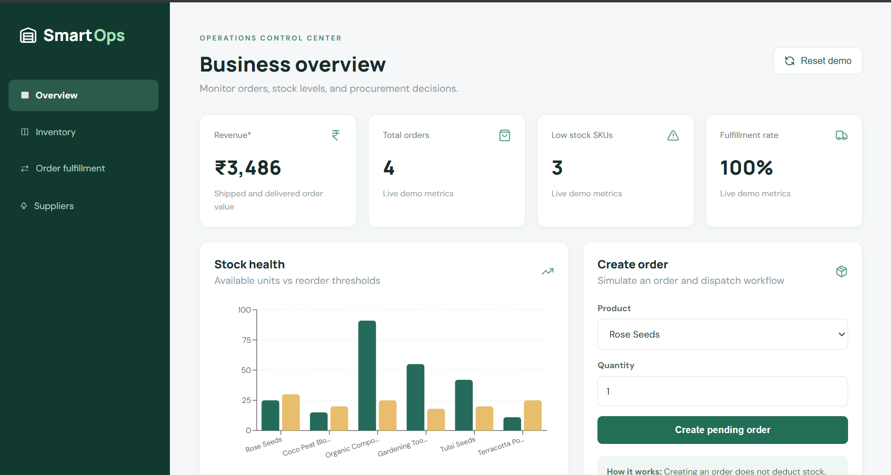

# SmartOps — E-commerce Operations Dashboard

A full-stack e-commerce operations management MVP designed to monitor inventory, order fulfillment, supplier performance, and key business metrics through a centralized dashboard.

Built using **React.js, Node.js, Express.js, and Recharts**, SmartOps demonstrates how digital tools can support inventory planning, warehouse operations, procurement decisions, and operational efficiency.

> **Note:** This is an independent portfolio project using simulated gardening-store data. It is not affiliated with The Affordable Organic Store or any real business.

## Application Screenshots

### 1. Business Overview Dashboard

The centralized dashboard displays revenue, total orders, low-stock products, fulfillment rate, and stock health.



### 2. Inventory & Replenishment

Monitors available stock, identifies low-stock products, and calculates suggested reorder quantities using predefined inventory thresholds.


### 3. Order Fulfillment

Tracks customer orders, quantities, and fulfillment statuses. Shipping an order automatically deducts available inventory.


### 4. Supplier Analytics

Compares suppliers based on delivery lead times, on-time delivery rates, and shipping costs to support procurement decisions.


## Key Features

### Inventory Management
- Product-level inventory tracking
- Automated low-stock identification
- Reorder suggestions based on inventory thresholds
- Stock updates and inventory valuation

### Order & Fulfillment Management
- Customer order creation
- Pending and shipped order tracking
- Automatic stock deduction upon shipment
- Prevention of duplicate shipment and insufficient-stock dispatch

### Supplier Management
- Supplier performance comparison
- Delivery lead-time analysis
- On-time delivery reliability metrics
- Shipping-cost comparison

### Business Analytics
- Revenue monitoring
- Total order tracking
- Inventory availability analysis
- Order fulfillment rate calculation
- Interactive stock-health charts

## Tech Stack

| Component | Technology |
|---|---|
| Frontend | React.js, Vite |
| Backend | Node.js, Express.js |
| Data Storage | Local JSON |
| Visualization | Recharts |
| API | REST |
| Testing | Node.js Test Runner |
| Version Control | Git, GitHub |

## Project Structure

```text
smartops-repo/
├── client/
│   ├── src/
│   │   ├── main.jsx
│   │   └── style.css
│   ├── index.html
│   ├── package.json
│   └── vite.config.js
├── server/
│   ├── index.js
│   ├── logic.js
│   ├── logic.test.js
│   ├── seed.json
│   └── package.json
├── screenshots/
│   ├── dashboard.png
│   ├── Inventory Management.png
│   ├── Order Fulfillment.png
│   └── Supplier Analytics.png
├── .gitignore
├── LICENSE
├── package.json
└── README.md
```

## Installation & Setup

### Prerequisites

- Node.js 20+
- npm

### 1. Clone the Repository

```bash
git clone https://github.com/amankumarsharma1309/SmartOps-Ecommerce-Operations.git
cd SmartOps-Ecommerce-Operations
```

### 2. Install Dependencies

```bash
npm run install:all
```

### 3. Start the Application

```bash
npm run dev
```

### 4. Access the Dashboard

Frontend: http://localhost:5173

Backend API: http://localhost:4000

## Testing

Run the automated backend tests:

```bash
npm test --prefix server
```

Tests cover inventory calculations and order fulfillment rules.

## Example Workflow

1. Open the dashboard and review business KPIs.
2. Identify products marked as Low Stock.
3. Create a pending customer order.
4. Ship the order to deduct inventory.
5. Monitor updated order and fulfillment metrics.
6. Compare suppliers based on shipping cost and delivery reliability.
7. Reset demo data to restore the initial dataset.

## API Endpoints

| Method | Endpoint | Description |
|---|---|---|
| GET | `/api/health` | Check API health |
| GET | `/api/dashboard` | Fetch dashboard data |
| POST | `/api/orders` | Create an order |
| POST | `/api/orders/:id/ship` | Ship an order |
| PATCH | `/api/products/:id/stock` | Update inventory |
| POST | `/api/reset` | Reset demo data |

## System Architecture

React Dashboard → Vite API Proxy → Express Backend → JSON Storage

The backend manages orders, stock updates, operational calculations, and inventory rules.

## Current Limitations

SmartOps is a portfolio MVP, not a production-ready warehouse management system.

- Uses local JSON storage instead of MongoDB
- Reorder suggestions use fixed thresholds, not predictive machine learning
- Does not integrate with Shopify, Zoho Inventory, or Unicommerce
- Does not include authentication, live logistics integrations, or advanced returns management
- Uses simulated business data

## Future Enhancements

- MongoDB integration
- Demand forecasting using historical sales
- Returns and refund management
- Dedicated inventory and supplier management pages
- CSV import/export
- Cloud deployment

## License

This project is licensed under the MIT License. See [LICENSE](LICENSE).
